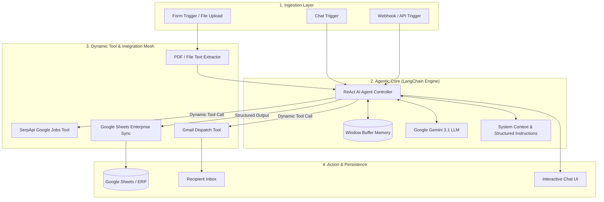
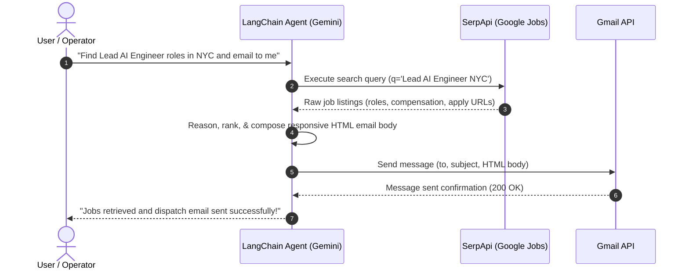

# 🤖 Enterprise AI Agents & Autonomous Workflows (n8n)

[](https://n8n.io/)
[](https://www.langchain.com/)
[](https://ai.google.dev/)
[](https://serpapi.com/)
[](https://workspace.google.com/)
[](LICENSE)

> A production-grade collection of **autonomous AI agents**, **intelligent document processing (IDP) pipelines**, and **event-driven automations** built using **n8n** and **LangChain**. Engineered for reliability, low-latency execution, multi-tool orchestration, and real-world enterprise adoption.

---

## 📌 Executive Summary

Modern automation has evolved beyond static, brittle rule engines. This repository showcases **state-of-the-art agentic workflows** designed with modern AI engineering principles:

- **ReAct (Reasoning + Acting) Agent Architectures**: Autonomous agents equipped with conversational memory and dynamic tool execution (web search, email dispatch, computational engines).
- **Intelligent Document Processing (IDP)**: End-to-end OCR and zero-shot schema extraction pipeline for complex invoices, structured into relational databases and spreadsheets.
- **Multimodal & Cost-Optimized LLMs**: Powered by **Google Gemini (including Gemini 3.1 Flash-Lite)** for ultra-fast inference and high accuracy with minimal token overhead.
- **Enterprise Integrations**: Secure OAuth2 integrations across **Google Workspace (Gmail, Google Sheets)**, **SerpApi (Google Jobs engine)**, and webhook/form trigger endpoints.

---

## 🏛 System Architecture & Agent Design Pattern

The agents in this repository leverage the **n8n LangChain agent framework** following a modular architecture:



---

## 📂 Repository Structure

```plaintext
ai-agents-and-automation/
├── README.md                                  # Enterprise documentation & architectural blueprints
└── ai-automation/
    ├── AI-Job -Search-EmailAssistant/
    │   └── AI Job Search & Email Assistant.json  # Multi-tool agent: SerpApi Jobs + Gemini + Gmail
    ├── Invoice-Data-Extraction/
    │   └── Invoice Data Extraction.json         # Automated Form PDF OCR + Gemini Agent + Google Sheets Sync
    ├── ai-email-assistant/
    │   └── AI Email Assistant.json              # Gemini 3.1 Flash-Lite conversational email assistant
    └── Calculater.json                        # Conversational computation & multi-turn memory reasoning agent
```

---

## 🚀 Workflows Showcase & Technical Deep Dives

### 1. 💼 AI Job Search & Intelligent Email Assistant
* **Path**: [`ai-automation/AI-Job -Search-EmailAssistant/AI Job Search & Email Assistant.json`](file:///home/sandeep/ai-agents-and-automation/ai-automation/AI-Job%20-Search-EmailAssistant/AI%20Job%20Search%20&%20Email%20Assistant.json)
* **Architecture Pattern**: Multi-Tool Conversational ReAct Agent
* **Core Technologies**: `n8n LangChain Agent (v3.1)`, `Google Gemini Chat Model`, `Simple Window Buffer Memory`, `SerpApi (google_jobs engine)`, `Gmail Tool (OAuth2)`

#### How It Works:
1. **Interactive Prompt**: The user initiates a conversational query (e.g., *"Find Senior Python / AI Engineer remote positions in the US and email the top 5 matches with salary details to recruiter@example.com"*).
2. **Autonomous Tool Selection**: The Gemini agent parses the intent, decomposes the request, and invokes the `Google_jobs search in SerpApi` tool with dynamically generated search parameters.
3. **Data Synthesis & Formatting**: The agent extracts title, company, salary ranges, location, description, and direct application links, styling them into an HTML-formatted briefing.
4. **Action Execution**: The agent automatically invokes the `Send a message in Gmail` tool, stripping extraneous tokens and delivering the curated briefing directly to the target recipient.



---

### 2. 📑 Intelligent Invoice Data Extraction & ERP Sync
* **Path**: [`ai-automation/Invoice-Data-Extraction/Invoice Data Extraction.json`](file:///home/sandeep/ai-agents-and-automation/ai-automation/Invoice-Data-Extraction/Invoice%20Data%20Extraction.json)
* **Architecture Pattern**: Zero-Shot Structured Extraction & Pipeline ETL
* **Core Technologies**: `n8n Form Trigger (v2.6)`, `Extract from File (PDF binary parser)`, `Gemini Reasoning Agent`, `Google Sheets Node (v4.7)`

#### How It Works:
1. **Form Portal**: Operators or vendors upload invoice documents (PDF) via a branded, secure web form.
2. **Text Parsing**: The binary PDF payload is stripped and parsed into raw text data using the `Extract from File` engine.
3. **Structured Entity Extraction**: The LangChain agent applies zero-shot semantic extraction with strict constraints, converting unstructured OCR noise into clean, validated JSON:
```json
{
  "company_name": "Acme Industrial Supplies LLC",
  "invoice_number": "INV-2026-9041",
  "invoice_date": "2026-10-12",
  "due_date": "2026-11-12",
  "billed_to": "Enterprise Solutions Corp",
  "description": "Cloud Migration & ML Pipeline Orchestration",
  "qty": 1,
  "total_amount": "$14,500.00"
}
```
4. **Spreadsheet / ERP Ingestion**: The parsed JSON is mapped into columns (`Supplier Name`, `Invoice Number`, `Due Date`, `Total Amount`, etc.) and instantly appended to the designated Google Sheet for downstream accounting and audit trails.

---

### 3. ✉️ Autonomous AI Email Assistant
* **Path**: [`ai-automation/ai-email-assistant/AI Email Assistant.json`](file:///home/sandeep/ai-agents-and-automation/ai-automation/ai-email-assistant/AI%20Email%20Assistant.json)
* **Architecture Pattern**: Conversational Copilot with Tool Augmented Action
* **Core Technologies**: `Google Gemini 3.1 Flash-Lite`, `Window Buffer Memory`, `Gmail Tool`

#### How It Works:
- Designed as an executive assistant copilot that converts conversational natural language commands into verified email transmissions.
- Utilizes `gemini-3.1-flash-lite` for ultra-low latency response times and reduced API operational expenditure.
- Features multi-turn conversational memory so the user can iteratively refine drafts before granting permission to dispatch.

---

### 4. 🧮 Conversational AI Reasoning & Calculation Agent
* **Path**: [`ai-automation/Calculater.json`](file:///home/sandeep/ai-agents-and-automation/ai-automation/Calculater.json)
* **Architecture Pattern**: State-Preserving Chat Reasoning Agent
* **Core Technologies**: `Chat Trigger`, `Simple Memory (Buffer Window)`, `Gemini Chat Model`

#### How It Works:
- A foundational building block for multi-step algorithmic operations, financial projections, currency/unit conversions, and multi-turn numerical reasoning.
- Maintains conversation history across multiple turns to resolve context-dependent arithmetic and formula derivations.

---

## 🛠 Prerequisites & Dependencies

To deploy and execute these workflows in your own environment:

| Service / Tool | Purpose | Requirement |
| :--- | :--- | :--- |
| **n8n** | Workflow Orchestration Platform | Self-hosted (Docker) or n8n Cloud (v1.x+) |
| **Google Gemini API** | Large Language Model Provider | API Key from [Google AI Studio](https://aistudio.google.com/) |
| **SerpApi** | Live Search & Job Scraping API | API Key from [SerpApi](https://serpapi.com/) |
| **Google Cloud Project** | Gmail & Google Sheets OAuth2 Access | Enabled Gmail API & Google Sheets API credentials |

---

## ⚡ Quickstart Deployment Guide

### Option 1: Quick Import via n8n UI
1. Clone this repository:
   ```bash
   git clone https://github.com/sandeep1988/ai-agents-and-automation.git
   cd ai-agents-and-automation
   ```
2. Open your n8n web interface.
3. Click **Workflows** > **Import from File...** (or press `Ctrl + O` / `Cmd + O`).
4. Select any `.json` workflow from the `ai-automation/` folder.
5. Configure the credentials (see table below).
6. Toggle the workflow to **Active**.

### Option 2: Running n8n Locally with Docker

If you don't already have an n8n instance, run the following command to spin up a pre-configured instance:

```bash
docker run -d \
  --name n8n-automation-engine \
  -p 5678:5678 \
  -e N8N_DIAGNOSTICS_ENABLED=false \
  -e N8N_PERSONALIZATION_ENABLED=false \
  -e N8N_ENFORCE_SETTINGS_FILE_PERMISSIONS=true \
  -v ~/.n8n:/home/node/.n8n \
  docker.n8n.io/n8nio/n8n:latest
```

Access n8n at `http://localhost:5678`.

---

## 🔑 Credential Configuration Matrix

Once imported, attach your credentials in n8n for each respective node:

| Node Name | Credential Type in n8n | Notes |
| :--- | :--- | :--- |
| **Google Gemini Chat Model** | `Google Gemini API` | Set your `apiKey` from Google AI Studio. |
| **Google_jobs search in SerpApi** | `SerpApi API` | Required for Google Jobs search automation. |
| **Send a message in Gmail / Gmail** | `Gmail OAuth2 API` | Scopes: `https://mail.google.com/` or `gmail.send`. |
| **Append row in sheet** | `Google Sheets OAuth2 API` | Scopes: `spreadsheets` edit access. Update the target spreadsheet ID. |

> [!TIP]
> In the **Invoice Data Extraction** workflow, replace the sample `documentId` and `sheetName` with your own Google Spreadsheet URL where extracted line items should be appended.

---

## 🛡 Production Best Practices & Engineering Highlights

This repository adheres to senior-level enterprise AI automation standards:

1. **Deterministic Structured Outputs**:
   - Rather than relying on arbitrary text outputs, prompts strictly enforce JSON formatting without markdown enclosures, enabling reliable parsing by downstream nodes (`JSON.parse($json.output)`).
2. **Defensive Expression Handling**:
   - Dynamic parameters employ sanitization patterns (e.g., `.replace(/^[^a-zA-Z0-9]+/, '').trim()`) to prevent format errors and injection attacks during automated email dispatch.
3. **Cost-Performance Optimization**:
   - Light workflows (such as email triage) explicitly leverage `models/gemini-3.1-flash-lite`, slashing inference latency to sub-second speeds while preserving reasoning capability.
4. **State Isolation**:
   - Conversational agents utilize buffer window memory configurations to bound token consumption and eliminate runaway LLM context overhead.

---

## 🗺 Roadmap & Future Enhancements

- [ ] **Vector Database & RAG Support**: Integration with Qdrant / Pinecone for knowledge retrieval on enterprise documentation.
- [ ] **Multi-Agent Collaboration**: Supervisor-Worker orchestration dividing research, copywriting, and quality assurance across separate specialized agents.
- [ ] **Slack / Teams Bot Integrations**: Webhook-based interactive chatbots for internal enterprise communication.
- [ ] **Automated Unit Testing & Mocking**: JSON validation and test harness for continuous integration of n8n workflows.

---

## 👨‍💻 Author

**Sandeep Chourey**
* **GitHub**: [@sandeep1988](https://github.com/sandeep1988)
* **Email**: [schourey1988@gmail.com](mailto:schourey1988@gmail.com)
* **Focus**: Generative AI, Autonomous Agents, Enterprise Automation Architecture & Full-Stack Development

---

## 📄 License

This repository is distributed under the [MIT License](LICENSE). Feel free to use, adapt, and scale these workflows in personal or commercial environments.
